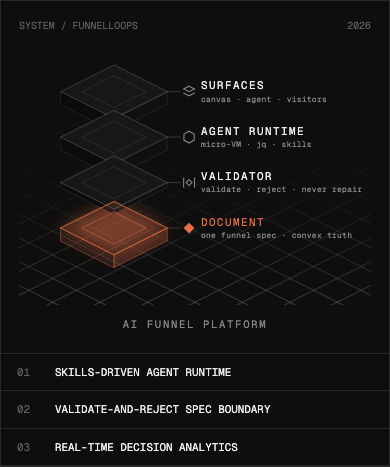
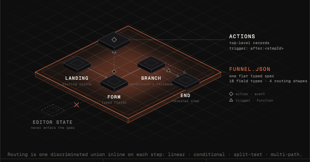

# Marvin's Agent Skills

[](https://skills.sh/marvinamador7/skills)

Reusable [agent skills](https://www.skills.sh/) for Claude Code and other SKILL.md-compatible agents.

## Install

```bash
npx skills add MarvinAmador7/skills
```

## Skills

### isometric-blueprint-illustration

Build **isometric system illustrations** in a restrained, technical "blueprint" aesthetic: extruded slabs on an isometric floor grid, one reserved accent color, thin 1px lines, and monospace micro-labels. Inline SVG geometry styled with Tailwind utilities, no companion stylesheet, no 3D library.

It covers two composition families:

- **Layered stacks** for hero illustrations of a system's architecture (surfaces → logic → data, trust/authority stacks)
- **Flow and system diagrams** with a semantic shape vocabulary: square slab = step/record/component, diamond = action/event, triangle = trigger/function, plane = boundary, dashed ghost + red ✕ = forbidden

| Hero stack | System diagram |
| --- | --- |
|  |  |

The aesthetic collapses into the generic "AI dashboard" look without discipline, so the skill is built around hard rules: one accent color reserved for the single most important element, thin strokes, a flat framed panel with at most one soft glow, mono micro-labels, an isometric grid on the same ±0.5 axes as the shapes, and colors pulled from your design tokens.

Ships with two working references to adapt: `reference-implementation.tsx` (a complete stacked-slab hero) and `reference-kit.tsx` (shared primitives for building sets of flow diagrams — slabs, tile-scale event/function nodes, flow lines with chevrons, labels, legend). Both are plain SVG math in React/Tailwind and port easily to other stacks. The SKILL.md also documents the verified Tailwind v4 gotchas: JIT-invisible interpolated classes, the `translate` vs `transform` transition trap, ancestor-hover variants, and SVG defs-id collisions across sibling diagrams.

## License

MIT
