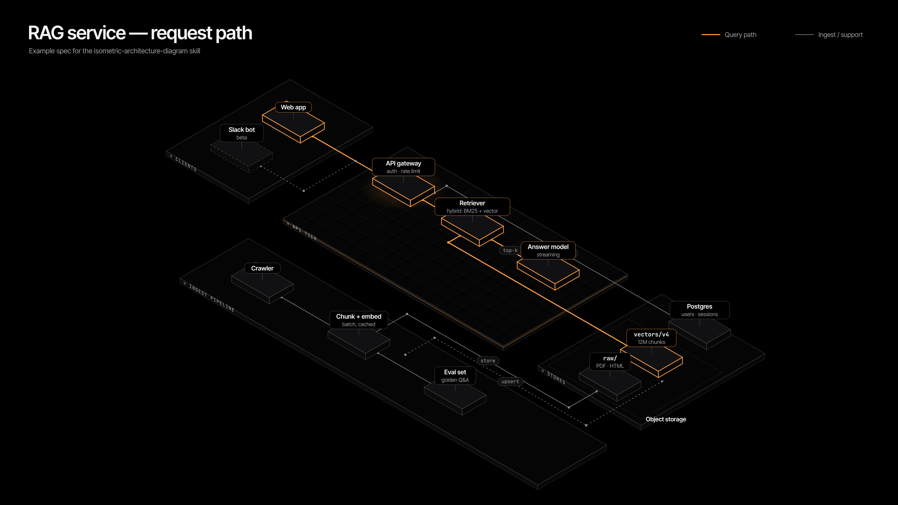

# isometric-architecture-diagram

JSON spec → dark isometric architecture diagram (SVG + 2x PNG). See `SKILL.md`.

## Credits

The visual language comes from the ontology diagrams on the **g-ops landing page**
(`apps/landing/src/app/[lang]/home-client.tsx`, the `OntologyPlane` and `OntologySystem`
components in ventures-from-the-loop/g-ops). Those diagrams in turn reinterpret Palantir's
Foundry architecture-center diagrams ([ontology system](https://palantir.com/docs/foundry/architecture-center/ontology-system/),
[platforms](https://palantir.com/docs/foundry/architecture-center/platforms/)). Ideas taken:
true-isometric slab with a thin extruded edge and inset strata lines, objects on a lattice,
Manhattan-routed relationship "streets" that bundle on purpose, verb pills on edges, mono
uppercase micro-labels, one soft glow under the key object. No code or content was copied;
the generator is a fresh, dependency-free implementation.
